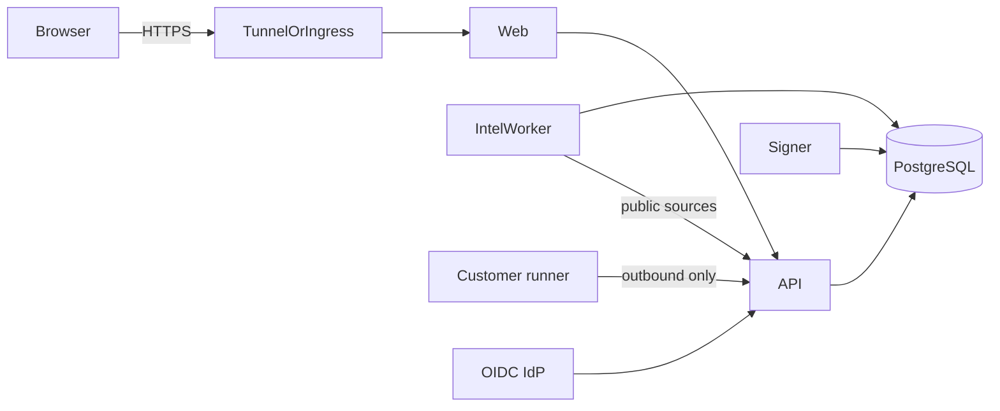

# Architecture and data flow

## Components

| Component | Role |
|-----------|------|
| Web | UI; proxies to API |
| API | Authz, product APIs, session store |
| Intelligence worker | Collectors with DB advisory locks |
| Evidence signer | Lease-based signing; private key only here |
| PostgreSQL | Durable state (customer-managed in pilot) |
| Customer runner | Outbound job plane in customer network |
| Ingress/TLS | Customer or Cloudflare Tunnel (reference only) |

## Data flow (simplified)

1. Public collectors write intelligence tables (not customer secrets)
2. Workspace inventory + connectors (when authorized) produce exposure context
3. Correlation proposes relevance; humans review
4. Readiness actions require approval; evidence attaches to actions
5. Signer seals manifests; verification is offline-capable with public key

Reference Compose can use an outbound tunnel. Pilot Kubernetes/Compose expects customer TLS and external Postgres.
