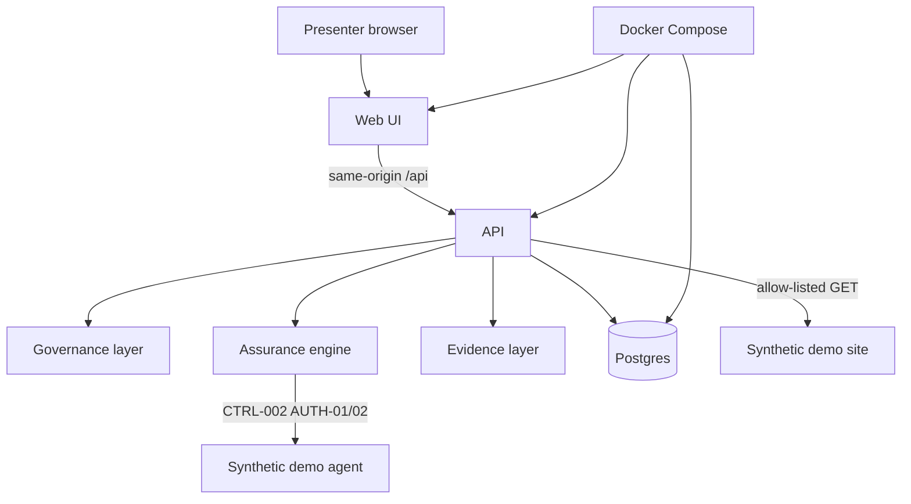

# Showcase architecture

Enterprise view of ThreatSight 2 as demonstrated. No new services were added for this package.

## Presenter diagram



## Layers

| Layer | What it is | What it is not |
| --- | --- | --- |
| Web UI | Dashboard, showcase, inventory, controls, tests, findings | News globe, SSO console |
| Governance | AI systems, requirements, controls, mappings, reviews | GRC product, legal register |
| Assurance engine | Deterministic CTRL-002 on the synthetic agent | Generic scanner, exploit engine |
| Evidence | Manual records and hashed observation envelopes | Legal certification file |
| Database | Postgres system of record | Multi-tenant SaaS store |
| Docker | Lab Compose; enterprise overlay unpublished Postgres | Cloud marketplace |

## Deployment

```text
make up
  → allocate .runtime-ports
  → postgres, demo-agent, demo-site, api, web
  → smoke health, meta, key UI routes
```

Demo agent and demo site use Compose DNS only. They are not published on the host.

Full runtime notes: [../architecture.md](../architecture.md), [../deployment.md](../deployment.md).
